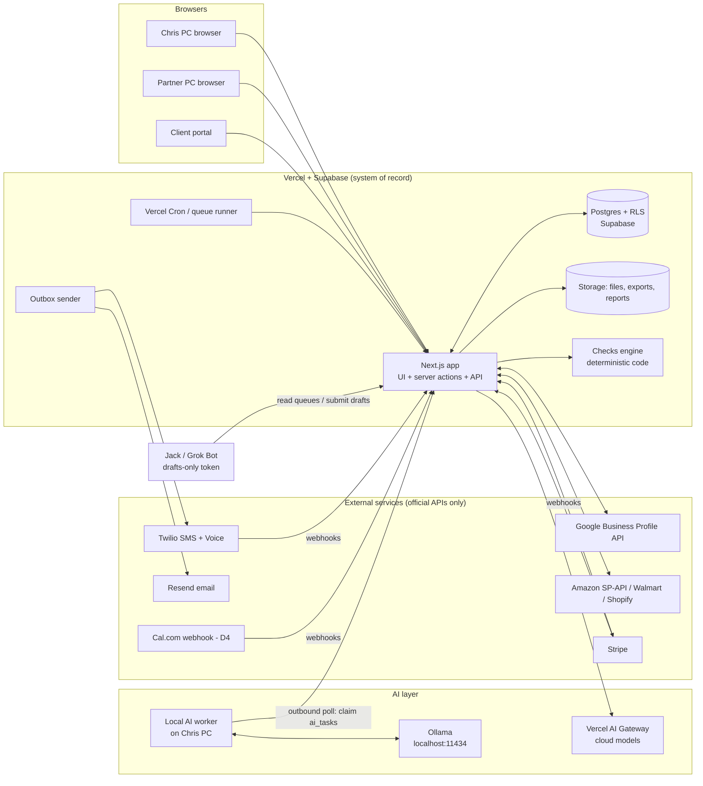
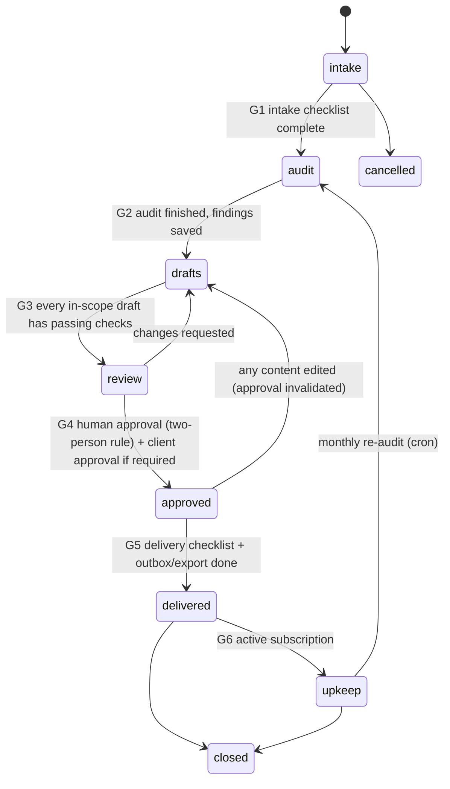
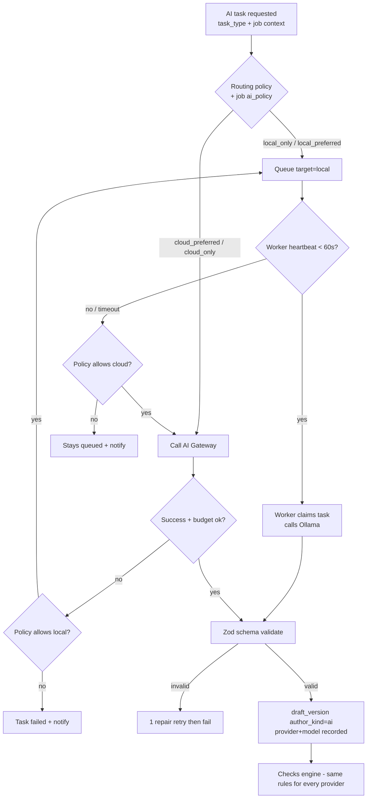

# Ops Hub — Build Plan (Claude-ready spec)

Working name: **Ops Hub** (rename in Decision D1). Owner: Chris Mosley (GitHub `damozman`), Fort Worth TX.
Plan written 2026-11-25 (Central); revised 2026-11-25 23:50 Central after Chris decided D6 and D13. All effort, cost and timeline figures are **estimates** unless a source is cited. Prices were checked 2026-11-25; re-check before buying.

### Decisions recorded
- **D6 — decided:** Chris's PC has a **32 GB VRAM GPU** and already runs other offline Ollama systems well. Deployment = **M2: cloud app (Vercel + Supabase) + local AI worker on Chris's PC.** The partner uses the same cloud app from her own PC; her AI tasks also run on Chris's GPU through the worker, so nothing on Chris's PC has to be opened to the LAN for her. Optional LAN-only offline mode (M3) stays in Phase 8. Local models: see §4.8 (verified on ollama.com 2026-11-25).
- **D13 — decided:** Start **Phases 0–2 now**, foundation-first, while selling continues. Phases 0–2 were adjusted (see §7) so they lay every schema hook later phases need and require no new paid sign-ups; nothing later is delayed. Kickoff prompt: `CLAUDE_KICKOFF_PHASES_0-2.md`.

---

## 0. How to use this file with Claude

1. Put this file at `docs/BUILD_PLAN.md` in a **new, separate** repo (Chris creates it; nothing here creates repos).
2. Work **one phase at a time**. Start each Claude session with:
   > Read `docs/BUILD_PLAN.md` sections 1–6 and the section for Phase N. Implement Phase N only. Do not change anything outside its scope. Write migrations, RLS policies and tests first. Stop when every acceptance criterion for Phase N passes, then list what you did and anything you could not finish.
3. Every phase ends with a PR. CI must pass (lint, typecheck, unit, RLS tests, e2e). Jack (Grok Bot) reviews the PR when Chris asks; Chris merges.
4. Never paste real client data, API keys or tokens into Claude chats. Use `.env.local` (git-ignored) and seed data that is invented.
5. If a requirement conflicts with a security rule in §5, the security rule wins; Claude must stop and flag it.

### Hard boundaries (Claude must not cross)
- This app is **separate from `aafes-pim-pipeline`**. Do not import from it, share its database, or change its roadmap. No AAFES/PIM templates, files or data enter this app.
- **FPD client files (AAFES work) never enter this app or reach Jack.** Enforced by the import guard in §5.6.
- **Nothing outbound without approval.** No email, SMS, post, review reply, listing push or invoice leaves the app unless the exact content was approved by a human with `approve` permission (§3.4).
- **Clients own their accounts.** Access only through OAuth / manager / collaborator roles. The app never stores a client password, and has no field that could hold one.
- Chris's existing **Cal.com FPD intake must not be modified** by code. See Decision D4.

---

## 1. Product summary

One app that runs two (later more) agency offers end to end, with enforced controls:

| Brand | Offer | What the app does |
|---|---|---|
| First Pass Data (FPD) | **Offer A — AI-shopping listing optimization** (Amazon, Walmart, Shopify; Alexa for Shopping, ChatGPT shopping) | Import listings (CSV/flat file or official APIs), score vs marketplace + AI-shopping requirements, AI-draft fixes, check, review, approve, export flat files / push via API, monthly re-audit and report |
| 369 Agentic Systems | **Offer B — Local visibility** (Google Business Profile, review requests, AI-search visibility, missed-call text-back) | GBP audit via official API, NAP/citation checks, AI-mention checks, review monitoring, post/reply drafting, compliant review-request campaigns, missed-call text-back, monthly report |

Shared platform: CRM (contacts, companies, deals), lead forms, booking, tasks, comments/mentions, notifications, proposals, Stripe invoicing, client portal, workflows/automations, AI layer (cloud gateway **or local Ollama**), Jack drafts-only integration, full audit log. Multi-brand now, multi-tenant-ready for a possible SaaS v2.

### Users
| Person | Role | Machine |
|---|---|---|
| Chris | `owner` | his PC (also hosts the optional local AI worker / LAN mode) |
| Partner (friend) | `operator` (can be raised to `admin`) | her own PC, browser only |
| Clients | `client` (portal only, per client account) | anywhere |
| Jack (Grok Bot) | `service:drafts` token | cloud; API only |
| Local AI worker | `service:worker` token | Chris's PC |

---

## 2. Architecture



Key ideas:
- **Postgres is the single source of truth.** Every state change goes through a database function that checks permissions and stage rules and writes the audit log in the same transaction.
- **AI never writes final content.** AI output becomes a `draft_version`; the deterministic **checks engine** runs on every version no matter which model (cloud, local, or Jack) wrote it.
- **Outbound is an outbox.** Approved items become `outbox_messages`; a sender job delivers them only if the approval hash still matches the content.
- **The local AI worker connects outward** to the app (poll/claim). No inbound ports on Chris's PC are needed for the default deployment.

### 2.1 Tech stack (recommended)
| Layer | Choice | Why |
|---|---|---|
| App | Next.js (current stable, App Router) + TypeScript strict, Tailwind + shadcn/ui | Chris already uses Vercel/GitHub; one codebase for UI + API |
| DB/Auth/Storage | Supabase Postgres, Supabase Auth (email magic link + TOTP MFA), RLS, Storage | RLS enforces tenant/brand/role isolation in the DB itself |
| Migrations | Supabase CLI SQL migrations; types via `supabase gen types` | Plain SQL is reviewable; RLS lives with schema |
| Validation | Zod everywhere (forms, API, AI structured output) | Same schemas for cloud and Ollama structured output |
| AI | Vercel AI SDK; providers: AI Gateway (cloud) and Ollama (OpenAI-compatible `/v1`) | Provider-agnostic; one interface |
| Jobs | `jobs_queue` table (Postgres, `FOR UPDATE SKIP LOCKED`) + Vercel Cron every 1–5 min; optional Vercel Workflow later | Simple, inspectable, works with local worker |
| Email | Resend | Simple API, free tier for early volume |
| SMS/Voice | Twilio (A2P 10DLC registered) | Missed-call text-back, review requests |
| Payments | Stripe (test mode in dev; Invoicing + Billing) | Invoices, subscriptions, portal payments |
| PDF | `@react-pdf/renderer` or Playwright print-to-PDF in a worker | Reports, proposals |
| Monitoring | Sentry (free tier), Vercel logs | Errors with PII scrubbing |
| Tests | Vitest (unit), pgTAP or SQL test scripts via `supabase test db` (RLS), Playwright (e2e) | RLS must be tested, not assumed |

### 2.2 Deployment modes (Decision D6)
| Mode | What runs where | Works offline? | Notes |
|---|---|---|---|
| **M1 Cloud** | App on Vercel, DB on Supabase, AI via Gateway | No | Simplest |
| **M2 Cloud + local AI worker — CHOSEN (D6)** | M1 plus `ops-worker` + Ollama on Chris's PC (32 GB VRAM) | AI drafting keeps working if the gateway is down or budget is hit; app needs internet | Worker polls outward; no ports opened. Partner's PC uses the cloud app; her local-AI tasks run on Chris's GPU via the worker |
| **M3 Self-hosted LAN** | `docker compose` on Chris's PC: Next.js app, Supabase local stack, Ollama; partner reaches `http://<chris-pc>:3000` on the home LAN (or Tailscale) | Yes, for core work (see §4.8) | Webhooks (Twilio, Stripe, Cal.com) need a tunnel (Cloudflare Tunnel) when online; Chris's PC must be on; backups are Chris's job |

Rule: **one system of record per organization.** M3 is not a sync of M1; pick one. (Two-way sync is out of scope for v1.) The same codebase supports all three via env vars (`DEPLOY_MODE=cloud|lan`).

---

## 3. Domain model and controls

### 3.1 Roles and permissions
| Permission | owner | admin | operator | reviewer | viewer | client | service:drafts (Jack) | service:worker |
|---|---|---|---|---|---|---|---|---|
| Manage org, billing, members, integrations, secrets | ✔ | ✔ (no billing) | | | | | | |
| CRM read/write | ✔ | ✔ | ✔ | read | read | | read (masked PII) | |
| Create/assign jobs, tasks | ✔ | ✔ | ✔ | | | | | |
| Run audits, request AI drafts | ✔ | ✔ | ✔ | | | | ✔ (request only) | |
| Write drafts | ✔ | ✔ | ✔ | | | | ✔ | ✔ (AI results only) |
| Approve drafts (internal) | ✔ | ✔ | configurable | ✔ | | | ✗ never | ✗ never |
| Client approval (portal) | | | | | | ✔ own account | | |
| Release outbox / deliver / publish | ✔ | ✔ | configurable | | | | ✗ never | ✗ never |
| See OAuth connections / tokens | metadata only | metadata only | | | | | ✗ | ✗ |
| View audit log | ✔ | ✔ | own actions | | | | | |
| Manage prompts, checks, routing | ✔ | ✔ | | | | | | |

- Decrypted OAuth tokens are **never returned to any client**; only server code in the integration module reads them.
- **Two-person rule** (setting per org, default ON once two humans exist): the approver of a draft must differ from its last human editor. Chris and partner review each other.
- Permissions are data (`role_permissions` table) and checked in **both** server code and RLS.

### 3.2 Tables (Postgres). All have `id uuid pk`, `org_id uuid not null`, `created_at`, `updated_at`, `created_by`. Brand-scoped tables also have `brand_id`.

**Tenancy & people**
- `orgs` (name, slug, plan, settings jsonb) — tenant root; v1 has one org (multi-tenant-ready).
- `brands` (org_id, key `fpd|369|...`, name, from_email, sms_sender_profile_id, logo_file_id, report_theme jsonb, legal_footer)
- `profiles` (user_id → auth.users, display_name, avatar, mfa_enabled)
- `memberships` (org_id, user_id, role, brand_ids uuid[] null=all, status)
- `role_permissions` (role, permission) — seeded
- `api_tokens` (org_id, name, kind `service:drafts|service:worker`, token_hash (argon2/sha256+pepper), scopes text[], allowed_brand_ids, expires_at, last_used_at, revoked_at, created_by)

**CRM**
- `companies` (name, website, industry, city, state, brand_ids, lifecycle `lead|prospect|client|churned`, source, tags)
- `contacts` (company_id, first, last, email, phone_e164, title, owner_user_id, tags, do_not_contact bool)
- `consents` (contact_id or phone/email, channel `sms|email`, purpose `marketing|transactional|review_request`, status `granted|revoked`, method, evidence jsonb, captured_at, revoked_at) — append-only
- `pipelines` (brand_id, name), `pipeline_stages` (pipeline_id, name, order, win_probability)
- `deals` (company_id, pipeline_id, stage_id, value_cents, offer `A|B|other`, expected_close, owner_user_id, status)
- `activities` (subject_type, subject_id, kind `note|call|email_logged|meeting|stage_change|system`, body, occurred_at)
- `tasks` (title, body, assignee_user_id, due_at, status, subject_type, subject_id, priority, recurring_rule)
- `comments` (subject_type, subject_id, body_md, mentions uuid[], resolved_at)
- `notifications` (user_id, kind, subject_type, subject_id, payload, read_at, channel `in_app|email`)
- `forms` (brand_id, name, schema jsonb, redirect_url, spam_protection, consent_text_version), `form_submissions` (form_id, data jsonb, ip_hash, contact_id, created_deal_id)
- `bookings` (brand_id, source `native|calcom`, external_id, contact_id, starts_at, ends_at, status, raw jsonb)
- `booking_types` (brand_id, name, duration_min, availability jsonb) — native booking for 369 (D4)

**Clients, jobs, pipeline gates**
- `client_accounts` (company_id, brand_id, status, data_sensitivity `public_only|client_confidential`, ai_policy `default|local_only`, portal_enabled, primary_contact_id)
- `jobs` (client_account_id, brand_id, offer `A|B`, title, stage `intake|audit|drafts|review|approved|delivered|upkeep|closed|cancelled`, assignee_user_id, reviewer_user_id, due_at, scope jsonb, requires_client_approval bool, sensitivity, current_approval_id)
- `job_stage_events` (job_id, from_stage, to_stage, actor_id, actor_kind `user|service`, reason, gate_results jsonb) — append-only
- `intake_checklists` (job_id, items jsonb [{key, label, done, done_by, evidence}])
- `job_items` (job_id, kind `listing|location|asset`, external_ref (ASIN/SKU/Item ID/GBP location name), marketplace `amazon|walmart|shopify|gbp|openai_feed`, title, status)

**Listing engine (Offer A)**
- `marketplace_profiles` (marketplace, category, version, required_fields jsonb, limits jsonb, rules jsonb, source_url, verified_at) — rule data, editable, versioned
- `source_snapshots` (job_item_id, origin `csv|flatfile|sp_api|walmart_api|shopify_api|manual`, payload jsonb, file_id, fetched_at, hash)
- `audits` (job_id, engine `listing|local`, rules_version, status, score numeric, started_at, finished_at)
- `audit_findings` (audit_id, job_item_id, rule_key, severity `blocker|major|minor|info`, field, message, evidence jsonb, suggested_fix)
- `drafts` (job_id, job_item_id, kind `title|bullets|description|attributes|backend_keywords|qa|gbp_description|gbp_post|review_reply|faq|email|sms|report_narrative|proposal_section`, status `draft|checks_failed|ready_for_review|changes_requested|approved|superseded|delivered`, current_version_id)
- `draft_versions` (draft_id, version int, content jsonb, content_hash sha256, author_kind `user|ai|jack`, author_id, ai_run_id, created_at) — immutable
- `check_runs` (draft_version_id, rules_version, passed bool, blocker_count, warning_count, ran_at), `check_results` (check_run_id, rule_key, severity, message, span jsonb, override_by, override_reason)
- `approvals` (subject_type `draft_version|bundle|outbox_message|deliverable`, subject_id, content_hash, approver_id, kind `internal|client`, decision `approved|rejected|changes_requested`, comment, decided_at) — append-only
- `deliverables` (job_id, kind `amazon_flatfile|walmart_spec|shopify_csv|openai_feed|report_pdf|gbp_publish|api_push`, file_id, status, approval_id, delivered_at, delivered_by)

**Local engine (Offer B)**
- `gbp_locations` (client_account_id, google_location_name, title, address jsonb, phone, website, categories jsonb, hours jsonb, last_synced_at, raw jsonb)
- `citations` (client_account_id, directory, url, name, address, phone, match_status `match|mismatch|missing|unknown`, checked_at, method `manual|api|import`)
- `ai_visibility_checks` (client_account_id, engine `chatgpt|gemini_ai_overviews|perplexity|grok|copilot`, query, location_context, method `manual|api`, mentioned bool, position int null, excerpt, screenshot_file_id, checked_by, checked_at)
- `reviews` (gbp_location_id, google_review_id, rating, text, reviewer_display, created_at_google, reply_status, reply_draft_id)
- `review_campaigns` (client_account_id, template_draft_id, channel, status, audience_rule jsonb) — audience rule cannot filter on sentiment (§3.5)
- `review_requests` (campaign_id, contact_id, outbox_message_id, sent_at, status)
- `phone_numbers` (client_account_id, twilio_sid, e164, forward_to_e164, missed_call_template_draft_id, a2p_campaign_status)
- `calls` (phone_number_id, twilio_call_sid, from_e164, status, duration, missed bool, text_back_outbox_id)

**Messaging & automation**
- `outbox_messages` (brand_id, channel `email|sms|gbp_post|gbp_reply|listing_push`, to, subject, body, payload jsonb, content_hash, approval_id, status `pending_approval|approved|queued|sent|failed|blocked|cancelled`, block_reason, scheduled_for, sent_at, provider_id)
- `message_templates` (brand_id, channel, name, body, variables, version, approved_version_id)
- `workflows` (brand_id, name, enabled, trigger jsonb, steps jsonb, version), `workflow_runs` (workflow_id, trigger_event_id, status, log jsonb)
- `events` (type, subject_type, subject_id, payload) — domain events feed workflows/notifications

**Money**
- `proposals` (deal_id, brand_id, status `draft|approved|sent|accepted|declined|expired`, total_cents, valid_until, pdf_file_id, accepted_at, accepted_by_name, accept_ip_hash)
- `proposal_items` (proposal_id, sku_key, description, qty, unit_cents, recurring `none|monthly`)
- `products_catalog` (brand_id, key, name, unit_cents, recurring, stripe_price_id) — your service menu
- `invoices` (client_account_id, stripe_invoice_id, status, amount_due_cents, due_at, paid_at, hosted_url) — mirror of Stripe
- `subscriptions` (client_account_id, stripe_subscription_id, status, current_period_end, items jsonb)

**AI layer**
- `ai_providers` (org_id, key `gateway|ollama_worker|ollama_direct`, enabled, config jsonb non-secret, health `up|down|unknown`, last_health_at)
- `ai_models` (provider_key, model_id e.g. `anthropic/claude-…` via gateway or `gpt-oss:20b`, capabilities text[] `json|vision|long_context|tools`, ctx_tokens, price_in_per_mtok, price_out_per_mtok, enabled)
- `ai_routing_policies` (task_type, primary_model_id, fallback_model_ids uuid[], policy `local_only|local_preferred|cloud_preferred|cloud_only`, max_cost_cents, timeout_s, temperature)
- `prompt_templates` (key, task_type, brand_id null, description), `prompt_versions` (template_id, version, system, user_template, output_schema jsonb, status `draft|active|retired`, changelog, created_by) — immutable once active
- `ai_tasks` (queue: job_id, task_type, prompt_version_id, input_ref jsonb, status `queued|claimed|done|failed|expired`, target `cloud|local|any`, claimed_by_worker_id, attempts, error)
- `ai_runs` (ai_task_id, provider_key, model_id, prompt_version_id, input_tokens, output_tokens, cost_cents (0 for local), latency_ms, fallback_from_run_id, schema_valid bool, created_at)
- `ai_workers` (name, api_token_id, host_label, models jsonb, last_heartbeat_at, status)
- `ai_budgets` (scope `org|brand|job`, monthly_cap_cents, alert_at_pct)

**Platform**
- `oauth_connections` (client_account_id or org-level, provider `google_gbp|amazon_sp|walmart|shopify|stripe|twilio`, scopes, external_account_id, enc_access_token bytea, enc_refresh_token bytea, key_version int, expires_at, status, granted_by_name, granted_at, revoked_at)
- `files` (bucket, path, mime, size, sha256, kind, sensitivity, retention_class, uploaded_by)
- `import_guard_signatures` (label, header_signature text[], action `block`) — §5.6
- `audit_log` (org_id, actor_id, actor_kind, action, subject_type, subject_id, before jsonb, after jsonb, ip_hash, user_agent, request_id, at) — append-only, no UPDATE/DELETE grants
- `retention_policies` (class, keep_days, action `delete|anonymize`)
- `settings` (org_id, key, value jsonb)

**v2 extension tables (create in Phase 8 as empty, feature-flagged)**
- `concierge_bots` (client_account_id, name, source_catalog_ref, embed_key, allowed_domains, status), `concierge_documents`, `concierge_conversations` (lead capture → `form_submissions`)
- `asset_packs` (job_id, kind `photo_pack|infographic|aplus`, status) for product photo/content packs
- `freelance_leads` (platform `upwork|contra|other`, url, title, budget, fit_score, proposal_draft_id, status)
- `referral_partners` (company_id, commission_pct, terms), `referrals` (partner_id, deal_id), `commissions` (referral_id, invoice_id, amount_cents, status)

### 3.3 Job state machine (enforced in DB)



Gates (implemented in `public.transition_job(job_id uuid, to_stage text, reason text)` SECURITY DEFINER; direct `UPDATE jobs SET stage` is revoked from all roles):
- **G1 intake→audit**: intake checklist all done: scope set, brand set, data sensitivity set, access confirmed (OAuth connection active OR "CSV import" chosen), client account owner contact set, signed proposal or Upwork contract reference recorded.
- **G2 audit→drafts**: latest `audits.status='finished'` for this job with `rules_version` recorded.
- **G3 drafts→review**: every draft in scope has `current_version` with a `check_runs.passed=true` (no blocker without a recorded override by owner/admin with reason).
- **G4 review→approved**: approval rows exist for every in-scope draft's **current content_hash**; approver ≠ last human editor (if two-person rule); if `requires_client_approval`, a `client` approval row exists for the bundle hash.
- **G5 approved→delivered**: deliverables generated from approved hashes; delivery checklist (backup of current live listing/profile taken, client notified) complete; all outbox items `sent` or deliverable files downloaded and marked uploaded by a user.
- **G6 delivered→upkeep**: an active Stripe subscription (or manual "upkeep agreed" with owner override).
- Any `draft_versions` insert on a draft in an approved job automatically moves the job back to `drafts` and marks old approvals stale (trigger).

### 3.4 Approval integrity
- `content_hash = sha256(canonical_json(content))`. Approvals bind to a hash, not to a row.
- Outbox sender refuses unless `outbox.content_hash == approvals.content_hash` and approval `decision='approved'` and approver has permission at decision time.
- Bulk approve is allowed only on items whose checks all pass with zero warnings; otherwise one-by-one.

### 3.5 Checks engine (deterministic, provider-independent)
Location: `src/server/checks/`. Pure TypeScript functions `(content, context) => CheckResult[]`, rules loaded from `marketplace_profiles` + `check_rules` data with versioning. Runs on **every** `draft_version` insert (server action or API), whoever wrote it (human, cloud model, local Ollama model, Jack). Severity `blocker` blocks G3; `warning` needs reviewer acknowledgement.

Seed rule packs (limits are **data**; seed values marked VERIFY must be confirmed against the current official style guide for the category before going live):
1. **Required fields** per marketplace/category profile (Amazon, Walmart, Shopify, OpenAI product feed: `item_id, title, description, url, brand, image_url, price, availability` per OpenAI's feed spec — https://developers.openai.com/commerce/specs/file-upload/products).
2. **Length limits**: Amazon title (VERIFY per category, commonly 200 chars max), bullets count/length (VERIFY), Walmart product name (VERIFY), GBP business description 750 chars, GBP post 1,500 chars, SMS segment math (GSM-7 160 / UCS-2 70; warn >2 segments).
3. **Banned claims**: guaranteed rankings/results ("guaranteed #1", "rank first", "guaranteed more sales"), unverifiable superlatives ("best", "#1") without a `substantiation` note, medical/disease/cure claims, "FDA approved", pesticide/antimicrobial claims, competitor brand names, promo/price/shipping text in titles, ALL CAPS words, emoji in Amazon content.
4. **Spec fidelity**: every numeric spec in a draft must match a value in `source_snapshots` or a client-provided answer; unmatched values = blocker "unverified spec".
5. **Reviews (Google policy + FTC 16 CFR Part 465)**: blocker if text or workflow implies review gating ("if you're happy…", "rate us first", routing by star rating), incentives for reviews ("discount/entry/gift for a review"), asking for positive reviews only, employee/insider reviews, or audience rules that filter by sentiment/satisfaction score. Google prohibits discouraging negative reviews or selectively soliciting positive ones (https://support.google.com/contributionpolicy/answer/7400114). FTC civil penalties can reach $53,088 per violation (per Venable, https://www.venable.com/insights/publications/2025/12/ftc-signals-heightened-enforcement-of-new).
6. **Review replies**: no customer personal data (names beyond first name, phone, order numbers, health info), no arguing language list, length.
7. **GBP content**: business name equals real-world name (no keyword stuffing), posts flagged for phone numbers/URLs in body, prohibited content keywords.
8. **SMS (TCPA/CTIA/A2P)**: brand name present, `Reply STOP to opt out` on first message to a number, consent row exists for purpose, A2P campaign status `approved` for the sender number, quiet hours (default 9:00–20:00 recipient local time; confirm with counsel), no SHAFT content, no URL shorteners.
9. **Email (CAN-SPAM)**: physical address + unsubscribe link for marketing, truthful subject, sender = brand domain.
10. **AI-disclosure & honesty**: no fabricated testimonials, no fake urgency, no statistics without a source note.
11. **Data-safety**: block if content contains strings matching secrets (API key patterns), full card numbers, or SSN patterns.

Output: `check_runs` + `check_results` with spans for highlighting in the review UI. Every rule has a unit test with pass and fail fixtures.

---

## 4. Feature specs

### 4.1 CRM & pipeline (GoHighLevel-style, built)
- Companies, contacts, deals with Kanban per brand pipeline (default stages: New lead → Contacted → Discovery booked → Proposal sent → Won / Lost).
- Cross-sell hooks: a company can be in both brands; panel "Other brand opportunity" shows rules like: FPD Offer A client with a physical location → suggest 369 Offer B; 369 client that sells products online → suggest Offer A; any client with a large catalog/site traffic → v2 concierge bot. Suggestions create a task, never an outbound message.
- Lead forms (embeddable script/iframe per brand, honeypot + rate limit + Turnstile optional), consent capture with versioned consent text.
- Native booking for 369 (`booking_types`, availability, Google Calendar free/busy optional later) — built in Phase 6. FPD keeps existing Cal.com (D4).
- Activities timeline, tasks with assignee/due/recurring, comments with @mentions → notifications (in-app + optional email digest).

### 4.2 Offer A listing engine
Sources (in order of preference):
1. **CSV / flat-file import** (Amazon category template exports, Walmart spec files, Shopify product CSV, client spreadsheets). Column-mapping UI with saved mappings per client.
2. **Official APIs with seller authorization**: Amazon SP-API Listings Items (seller authorizes your public app via OAuth; Amazon has cancelled planned SP-API fees — https://developer.amazonservices.com/cancellation-of-sp-api-fees), Walmart Marketplace (OAuth 2.0 via Walmart App Store for Solution Providers — https://developer.walmart.com/us-marketplace/docs/delegated-access-authorization), Shopify Admin API (collaborator / custom app). Each is a separate connector, feature-flagged; registration as a developer is Chris's step (D9).
3. **Public pages**: only where the site's terms allow. **Amazon's Conditions of Use prohibit robots/data extraction** of product listings, so the app does **not** scrape Amazon; for a non-client prospect "teaser audit", the user pastes visible text manually. Shopify storefront `/products.json` for a client's own store with their permission is fine.

Scoring: rule pack from `marketplace_profiles` + AI-shopping readiness rules (attribute completeness, use-case/compatibility Q&A coverage, image count, structured specs, consistent units, feed fields for ChatGPT shopping). Score 0–100 per item and per job, weights in data.

Drafting: per item, AI tasks for title, bullets, description, attributes, backend keywords, Q&A; all as drafts → checks → review.

Review UI: side-by-side before/after diff (word-level), check result highlights, "unverified spec" questions list exportable as a client questionnaire.

Exports: Amazon flat-file rows (template columns mapped from profile), Walmart spec JSON/XLSX, Shopify CSV, OpenAI product feed (CSV/JSON per spec). Export only from approved hashes; file stamped with job id + approval ids. API push (SP-API patchListingsItem etc.) only through outbox `listing_push`, after approval, with a pre-push backup snapshot.

Monthly upkeep: cron re-pull (API) or re-import reminder task (CSV), diff vs delivered version, findings → upkeep report.

### 4.3 Offer B local engine
- **GBP**: Google Business Profile APIs via OAuth after the client adds Chris's Google account as Manager. API access requires an application: a verified profile active 60+ days, a Cloud project, and the "Application for Basic API Access"; approval shows as 300 QPM quota (https://developers.google.com/my-business/content/prereqs). Until approved (D8), Offer B runs in **manual mode**: audit form + screenshots, drafts copied by a human into GBP after approval, marked done.
- Audit: profile completeness (categories, hours, services, description, photos count/recency, posts recency, Q&A, attributes), review velocity/rating/reply rate vs top 3 competitors (competitor data entered manually or from public Places data where ToS allows).
- **NAP/citations**: canonical NAP per client; citation list (top directories) with match status; method manual or import (BrightLocal CSV optional later). Mismatch → task.
- **AI-search visibility**: query sets ("best {service} in {city}", "{service} near {neighborhood}", "who is the most trusted {service} in {city}"), engines list, method:
  - Manual: operator runs query in a clean browser profile, pastes answer, uploads screenshot, app records mention/position. Checklist explains location/login variance.
  - API (optional, D10): engine APIs that return web-grounded answers (e.g. a model with web search via AI Gateway). Recorded with `method='api'`; reported as indicative, not ranking.
  - Results are spot checks; reports must never promise AI placement (blocked claim).
- **Reviews**: sync via GBP API (or manual), new-review notification, AI-drafted reply → checks → approval → `gbp_reply` outbox (API) or manual copy.
- **Posts**: content calendar, drafts, approval, publish via API or manual.
- **Review request campaigns**: send to **all** customers in the uploaded/connected list with identical neutral wording; audience rules may filter only on non-sentiment fields (date of service, consent present). Customer lists come from the client directly (CSV upload by client in portal or by operator), marked `client_confidential`, never sent to Jack or cloud AI.
- **Missed-call text-back**: Twilio number forwards to client phone; on `no-answer/busy` status callback, an outbox SMS is created from the **pre-approved template** (template approval counts as approval for each instance; variables limited to first name/business name); send only if A2P campaign approved and within quiet hours (else queued). Calls/texts log to CRM.

### 4.4 Messaging & outbox
- Email via Resend (per-brand verified domain), SMS via Twilio Messaging Service per client brand (A2P ISV model: each client business is a registered brand; D7).
- Inbound SMS: STOP/HELP handled automatically (consent revoked + audit log), replies land in a shared conversation inbox assigned to a user.
- Drafting with AI allowed; sending always via outbox after approval. Scheduled sends recheck consent at send time.

### 4.5 Proposals, invoicing, payments
- Proposal builder from `products_catalog` (Offer A setup, Offer A monthly care, Offer B setup, Offer B monthly, audits), PDF + portal accept (typed name + checkbox, IP hash, timestamp).
- Accept → creates Stripe customer, invoice (one-time) and/or subscription; Stripe-hosted payment pages only (the app never touches card data).
- Webhooks: `invoice.paid`, `invoice.payment_failed`, `customer.subscription.updated|deleted` update mirror tables and trigger workflows (e.g. move deal to Won, open job intake).
- Dev uses Stripe **test mode** keys only; seed data uses test customers.

### 4.6 Client portal
- Magic-link login scoped to one client_account. Sees: approvals waiting (bundle view with before/after), reports, invoices (links to Stripe hosted pages), upload area for customer lists/spec sheets (stored `client_confidential`), messages thread.
- Client approval records `kind='client'` against bundle hash.

### 4.7 Workflows & automations
- Trigger types: event (`deal.stage_changed`, `form.submitted`, `booking.created`, `invoice.paid`, `review.received`, `call.missed`, `job.stage_changed`, `check.failed`), schedule (cron), manual.
- Step types: create task, assign, notify, create job from template, request AI draft, wait/delay, condition, **create outbox message in `pending_approval`** (a workflow can never send directly — only the missed-call template path uses a pre-approved template).
- Seeded workflows: new form lead → task + notify; proposal accepted → create job + intake checklist; monthly 1st → re-audit + report draft for upkeep jobs; new review → reply draft; invoice failed → task.

### 4.8 AI layer (cloud gateway + local Ollama)



**Interface** (`src/server/ai/`):
```ts
interface AiProvider {
  key: 'gateway' | 'ollama_worker' | 'ollama_direct';
  generate<T>(req: { model: string; system: string; prompt: string; schema?: ZodType<T>;
    temperature?: number; maxTokens?: number; timeoutMs: number }): Promise<AiResult<T>>;
  health(): Promise<'up'|'down'>;
}
```
- `gateway`: Vercel AI SDK with AI Gateway (`AI_GATEWAY_API_KEY` server env). AI Gateway charges provider list price with no token markup (https://vercel.com/docs/ai-gateway/pricing); per-key budgets set in Vercel too.
- `ollama_worker` (default for M2): the app enqueues `ai_tasks` with `target='local'`; `ops-worker` (Node script in `/worker`, run on Chris's PC as a service) polls `POST /api/worker/claim` with its `service:worker` token, calls `http://127.0.0.1:11434/v1/chat/completions` with `response_format` JSON schema (Ollama supports OpenAI-compatible structured outputs — https://docs.ollama.com/api/openai-compatibility), posts `POST /api/worker/complete`. Heartbeat every 30 s.
- `ollama_direct` (M3 LAN mode): the app server calls `OLLAMA_BASE_URL` directly (same machine or LAN).
- **Context minimization**: prompts are built server-side from that job's data only (`buildContext(job_id, task_type)`), with PII stripped unless task needs it; `client_confidential` jobs with `ai_policy='local_only'` can never route to cloud or Jack.
- **Prompt templates** versioned; `ai_runs` stores prompt_version_id; changing a prompt = new version + changelog; A/B by routing policy optional.
- **Cost tracking**: `ai_runs.cost_cents` from model price table (local = $0 but latency recorded); dashboard by brand/job/month; budget caps → when cap reached, `cloud_preferred` tasks fall back to local, `cloud_only` tasks pause with notification.
- **Settings UI** (`/settings/ai`): toggle "Use local AI (Ollama)" on/off; "Offline mode" toggle (forces local, pauses internet-dependent jobs); per-task routing table editable; worker status (last heartbeat, models present); "Test connection" buttons.

Default routing (editable):
| task_type | Policy | Primary | Fallback |
|---|---|---|---|
| classify_lead, tag_review_sentiment (internal only, never used to filter review requests), dedupe | local_preferred | `llama3.2:3b` (resident) | small cloud model |
| extract_attributes (CSV/spec text → JSON) | local_preferred | `gpt-oss:20b` | `gemma4:31b`, then cloud mid model |
| draft_listing_copy (title/bullets/description/Q&A) | local_preferred | `gemma4:31b` | `gpt-oss:20b`, then cloud strong model |
| draft_gbp_post, draft_review_reply, draft_faq | local_preferred | `gemma4:31b` | `gpt-oss:20b`, then cloud mid |
| audit_summary_large (100+ SKUs, long context) | local_preferred (32 GB GPU) | `gemma4:31b` at 32K ctx, chunked | cloud long-context model |
| report_narrative, proposal_section | cloud_preferred | cloud strong | `gemma4:31b` |
| image_brief / vision (photo check) | local_preferred | `gemma4:31b` (image input) | `qwen3-vl:32b`, then cloud vision |
| ai_visibility_check_api | cloud_only (it queries online engines) | web-grounded model | — |
| embeddings (v2 concierge) | local_preferred | `qwen3-embedding:8b` | cloud embeddings |

**Recommended local models for Chris's 32 GB VRAM GPU (D6)** — tags and sizes verified on ollama.com library pages 2026-11-25 (https://ollama.com/library/gemma4, /gpt-oss, /qwen3, /qwen3-vl, /llama3.2, /qwen3-embedding, /embeddinggemma). Download sizes ≠ VRAM in use; context (KV cache) adds several GB.
| Role | Model tag | Download size / context | Notes |
|---|---|---|---|
| **Primary drafter** (listing copy, GBP posts, review replies, reports, image checks) | `gemma4:31b` | 19–20 GB · 256K · text + image | Best quality that fits 32 GB with room for ~16–32K context |
| **Fast drafter / structured extraction** | `gpt-oss:20b` | 14 GB · 128K | Strong JSON/structured output; fast. Use when speed matters or for bulk SKU extraction |
| Alternate fast MoE (A/B test vs gpt-oss) | `qwen3:30b` | 19 GB · 256K | Optional |
| Vision fallback (photo/infographic checks) | `qwen3-vl:32b` | 21 GB · 256K | Only if gemma4:31b image results are weak |
| **Small classifier** (lead sorting, tagging, dedupe) | `llama3.2:3b` or `gemma4:e4b` | 2.0 GB · 128K / 6.6–9.5 GB · 128K | Can stay loaded beside one large model |
| Embeddings (v2 concierge) | `qwen3-embedding:8b` (or `embeddinggemma:300m` for speed) | 4.7 GB | v2 only |
Rules for this GPU:
- Keep **one large model + one small model** resident (`OLLAMA_MAX_LOADED_MODELS=2`); `gemma4:31b` + `gpt-oss:20b` together (~34 GB of weights) do **not** fit — the worker must swap, so routing prefers one large model per batch.
- Worker concurrency **1** by default (`WORKER_CONCURRENCY=1`) because Chris's other offline systems share the GPU; a "pause local AI" toggle and quiet-hours window let him reserve the GPU. If the worker reports busy, `local_preferred` tasks fall back to cloud per policy.
- Set context per task (`num_ctx` 16K default, 32K for big audits) — Ollama's default is small.
- **Never route to Ollama `-cloud` tags** (`gemma4:cloud`, `gemma4:31b-cloud`, `gpt-oss:20b-cloud`, `qwen3-vl:235b-cloud`): they run on Ollama's servers, not Chris's PC. The worker rejects any model tag containing `cloud`, and `local_only` jobs are tested against this.
- Ollama stays bound to `127.0.0.1` for this app; if Chris's other systems already expose it on the LAN (`OLLAMA_HOST=0.0.0.0`), keep the Windows firewall rule limited to the home subnet.
- Disk: ~70 GB free for the models above.
Other hardware (for a future second machine or SaaS customers): 16 GB VRAM → `gpt-oss:20b` + `gemma4:12b` (7.7–8 GB); 8 GB → `gemma4:e4b`, `llama3.2:3b`; CPU only → `llama3.2:3b` for classification only.

**Offline behavior (M3 LAN mode, or M2 with "Offline mode" on for AI only):**
| Works offline (LAN mode) | Needs internet (queued until online) |
|---|---|
| CRM, tasks, comments, notifications (in-app) | Public listing fetch, SP-API/Walmart/Shopify API pulls and pushes |
| Jobs, stage gates, approvals, audit log | Google Business Profile API sync/publish |
| CSV/flat-file import and listing scoring | AI-search visibility checks |
| Local AI drafting (Ollama) | Cloud AI models (gateway) |
| Checks engine, diffs, exports to flat files | Email (Resend), SMS/calls (Twilio), missed-call text-back |
| Report/proposal PDF generation | Stripe invoices/payments, Cal.com webhooks, client portal access from outside |
| Partner works from her PC over home LAN | Jack integration |
Offline queue: outbox items, API pulls and cloud AI tasks stay `queued` with reason `offline`; a banner shows "Offline — N items waiting"; on reconnect they run in order, re-checking consent, quiet hours and approval hash.

Security for local AI: Ollama has **no built-in auth**; keep it bound to `127.0.0.1` in M2 (only the worker talks to it). In M3, bind to LAN only behind the OS firewall, or use Tailscale; never expose 11434 or the app port to the public internet without auth (https://setuproll.com/how-to/lai-1-use-ollama-openai-api).

### 4.9 Jack (Grok Bot) integration
- Token kind `service:drafts`, created by owner in `/settings/api-tokens`, shown once, stored hashed, expiry ≤ 90 days, revocable instantly, IP/rate limited (60 req/min), all calls in `audit_log`.
- Scopes: `queues:read`, `jobs:context:read` (public-source data + brief only; PII masked; no `client_confidential` jobs; no consents/contacts phone/email), `drafts:write`, `comments:write`, `tasks:read`.
- Endpoints (`/api/v1`): `GET /queues/drafting` (jobs at `drafts` stage needing items), `GET /jobs/:id/context`, `POST /jobs/:id/drafts` (creates `draft_versions` with `author_kind='jack'`, triggers checks), `POST /comments`, `GET /tasks?assignee=jack`.
- Explicitly **no** endpoints for approve, transition_job, outbox, deliverables, oauth_connections, invoices, files download of `client_confidential`. RLS denies these tables to the service role used for tokens (token requests run as a dedicated Postgres role `svc_drafts` with only the grants above).
- PR reviews: Chris asks Jack to review PRs on the GitHub repo; branch protection requires CI green + Chris's merge. Jack has no write access to `main`.

### 4.10 Reports
- Monthly report per client (brand themed): what changed, scores before/after, AI-visibility spot checks (labelled "spot check, varies by user/location"), reviews summary, posts published, tasks next month. Narrative AI-drafted → checks → internal approval → portal + email via outbox.

---

## 5. Security checklist (must pass before any real client data)
1. **RLS on every table**; default deny; policies by `org_id` membership, brand restriction, role permission; portal users limited to their `client_account_id`. RLS tests for every table (allowed + denied cases per role).
2. **Secrets** only in env vars (Vercel/`.env.local`); never in DB plain text, never in client bundles (`NEXT_PUBLIC_` only for non-secrets). Secret scanning in CI (gitleaks).
3. **OAuth tokens encrypted** with AES-256-GCM, key from `TOKEN_ENC_KEY` (32 bytes, base64), `key_version` for rotation; decrypt only in `src/server/integrations/*`; no API returns tokens.
4. **Least privilege**: OAuth scopes minimal per connector; service tokens map to restricted Postgres roles; Supabase service-role key used only in server jobs, never in request paths that take user input without checks.
5. **Auth**: MFA (TOTP) required for owner/admin/operator; session timeout 12 h; magic links expire 15 min.
6. **Import guard (FPD/AAFES separation)**: `import_guard_signatures` holds header signatures Chris enters from his AAFES/PIM templates; any upload matching ≥80% of a signature is rejected and logged. Brand FPD in this app is for marketplace listing work only. No code from `aafes-pim-pipeline`.
7. **Client owns accounts**: no password fields anywhere (lint rule/grep test for `password` columns outside Supabase auth); onboarding instructions use Manager/collaborator/OAuth flows.
8. **Webhooks verified**: Stripe signature, Twilio signature (`X-Twilio-Signature`), Cal.com secret; idempotency keys stored.
9. **Input safety**: Zod validation, CSV size limits (e.g. 20 MB), formula-injection escaping on exports (`=,+,-,@` prefixed cells), HTML sanitization of AI output before render.
10. **Prompt-injection hygiene**: imported listing text and reviews are treated as data in prompts (delimited), AI output can only become drafts; no tool calls that send or approve.
11. **Audit log** append-only (revoke UPDATE/DELETE; trigger blocks), includes service actors.
12. **Backups**: Supabase Pro daily backups (7-day retention on Pro — https://supabase.com/pricing) **plus** nightly `pg_dump` to an off-site bucket encrypted (GitHub Action or worker), monthly restore test. M3: nightly dump to external drive + off-site.
13. **Retention**: defaults — customer lists for review requests deleted 90 days after campaign end; call/SMS logs 24 months; audit log 7 years; drafts/reports life of client + 2 years; churned client data export then delete on request. Nightly retention job.
14. **PII in logs**: Sentry scrubbing; phone/email hashed in analytics.
15. **Dependency & CI**: Dependabot, `npm audit` high = fail, typecheck strict.
16. **Local AI**: Ollama bound to localhost (M2) or LAN+firewall (M3); worker token scoped `service:worker`.

---

## 6. Repository layout & conventions
```
/app                 Next.js routes (App Router)
  /(auth)/login
  /(app)/[org]/...   internal app
  /portal/[client]/  client portal
  /api/v1/*          Jack API (token auth)
  /api/worker/*      local AI worker API
  /api/webhooks/*    stripe, twilio/voice, twilio/sms, cal, resend
  /api/cron/*        scheduled jobs (Vercel Cron, secret header)
/src/server/{db,auth,checks,ai,integrations,outbox,workflows,reports,exports,audit}
/src/components      shadcn/ui based
/supabase/migrations SQL (schema, RLS, functions)
/supabase/tests      RLS + function tests
/worker              ops-worker (Node, runs on Chris PC) + README
/docker              docker-compose.lan.yml (M3)
/tests/e2e           Playwright
/docs                BUILD_PLAN.md, ADRs, runbooks
```
Conventions: server actions call domain services; domain services call DB functions for state transitions; every mutation writes `audit_log`; feature flags in `settings`.

### 6.1 Main routes (internal app)
`/dashboard` (my tasks, review queue count, outbox waiting, MRR, AI spend, worker status) · `/crm/companies` · `/crm/contacts` · `/crm/deals` (kanban) · `/tasks` · `/inbox` (notifications + conversations) · `/jobs` (board by stage) · `/jobs/[id]` tabs: Overview, Intake, Audit, Drafts, Review, Delivery, Upkeep, Activity · `/review-queue` · `/outbox` · `/listings/import` · `/local/locations` · `/local/reviews` · `/local/ai-visibility` · `/campaigns` · `/reports` · `/proposals` · `/billing` · `/forms` · `/booking` · `/workflows` · `/settings/{org,brands,members,integrations,ai,checks,prompts,api-tokens,workers,retention,import-guard}`.

### 6.2 Key components
`StageGateBar` (shows gates + blockers), `DiffViewer` (word diff + check spans), `CheckResultsPanel`, `ApprovalButton` (disabled with reason), `OutboxItem`, `KanbanBoard`, `ColumnMapper`, `ScoreCard`, `ReportBuilder`, `MentionInput`, `ActivityTimeline`, `RoutingTable`, `WorkerStatus`, `OfflineBanner`, `PortalApprovalBundle`.

---

## 7. Phases (each ends usable; build in this order)

Effort = Chris + Claude focused hours (estimate). At ~15 h/week the full plan is ~16–22 weeks; at ~25 h/week ~10–13 weeks.

**Foundation-first (D13).** Phases 0–2 are the prerequisites for every later phase, so building them now only moves the schedule earlier. To make sure nothing later has to be reworked, Phases 0–2 now also lay these hooks: `org_id` tenancy + `brand_id` on every table; `api_tokens` table and the restricted Postgres roles `svc_drafts` / `svc_worker` (grants added in Phase 3); `events` table written by every domain action from Phase 1 (consumed by workflows in Phase 6 and notifications now); `consents` table captured by forms from Phase 1 (used by SMS in Phase 6); `files` + Storage buckets and the import guard from Phase 1 (contact CSV import is the first upload); `draft_versions.author_kind` already allowing `ai|jack`; outbox status machine with a "mark sent manually" sender so Phase 6 only adds real senders; checks engine as a rule-data package Phases 4–6 extend. Native 369 booking moved from Phase 1 to Phase 6 (it needs email/SMS confirmations), so Phases 0–2 need **no new paid accounts**: only GitHub, Vercel and Supabase free tiers, with local email captured by Supabase's local mail catcher. **Do not pause selling while building**: Offer A jobs can be run manually (playbook) until Phase 4 lands, and first Offer B clients can run on HighLevel Starter (Decision D3) until Phase 6.

### Phase 0 — Foundation (20–30 h)
Scope: new repo under `damozman` (separate from `aafes-pim-pipeline`), Next.js + Supabase setup, CI (lint, typecheck, Vitest, `supabase test db`, Playwright smoke), envs (dev local Supabase, prod), auth with MFA, orgs/brands/memberships/roles/permissions, audit_log + triggers, settings, `api_tokens` table + `svc_drafts`/`svc_worker` roles with no grants yet, seed (one org, brands FPD and 369, Chris owner, partner operator, invented data), app shell with brand switcher.
Acceptance:
- [ ] Chris and partner can each sign in from their own PCs with MFA; partner cannot open `/settings/members`.
- [ ] RLS tests prove: user of org A cannot read org B; brand-restricted member cannot read other brand rows; portal role sees nothing internal.
- [ ] Every insert/update/delete on core tables writes `audit_log`; UPDATE/DELETE on audit_log fails.
- [ ] CI green on PR; gitleaks passes; no secrets in repo.

### Phase 1 — CRM, tasks, collaboration, intake (22–30 h)
Scope: companies, contacts, deals + kanban, pipelines per brand, activities, tasks (assign, due, recurring), comments with @mentions, notifications (in-app; email digest through a mailer interface that uses the local mail catcher in dev — Resend wired in Phase 6), lead forms (embed) with consent capture into `consents`, `events` emission, `files`/Storage + import guard, `bookings` table with a booking-link field only (Cal.com untouched; D4), cross-sell suggestion panel, CSV import of contacts.
Acceptance:
- [ ] Form submission creates contact + deal + task + notification in < 5 s; spam honeypot blocks bot fixture.
- [ ] @mention notifies the mentioned user only; comment edits logged.
- [ ] Deal stage change logs activity and audit entry; kanban drag works on both PCs concurrently (realtime or refresh).
- [ ] Cross-sell rule creates a task, never a message.
- [ ] No code path modifies Cal.com config.
- [ ] A form with the consent box ticked writes a `consents` row with the consent text version; every domain action writes an `events` row.
- [ ] A contact CSV matching an `import_guard_signatures` entry is rejected and logged.

### Phase 2 — Jobs, stage gates, checks engine, approvals, outbox (30–40 h)
Scope: client_accounts, jobs, job_items, intake checklist, `transition_job` with G1–G6, draft/draft_versions with hashing, checks engine with rule packs 1–11 (data-driven), review queue, approvals (internal, two-person rule), outbox (status machine, no live senders yet — "mark sent manually"), deliverables placeholder, job board UI, `StageGateBar`, `DiffViewer`.
Acceptance:
- [ ] Direct `UPDATE jobs SET stage` is rejected; `transition_job` refuses each gate with a clear reason (test per gate).
- [ ] Editing an approved draft invalidates approval and moves job back to `drafts`.
- [ ] Approver = last editor is blocked when two-person rule is on.
- [ ] Each seed rule has passing and failing fixtures; a review-gating phrase ("if you loved your visit…") is a blocker; "guaranteed #1 ranking" is a blocker.
- [ ] Outbox refuses an item whose content hash ≠ approved hash.
**Usable now:** run Offer A/B jobs with human-written drafts and full controls.

### Phase 3 — AI layer: gateway + Ollama + Jack (25–35 h)
Scope: provider abstraction, AI Gateway provider, `ops-worker` + Ollama provider, `ollama_direct` for LAN, routing policies + fallback + timeouts, settings toggles (local AI on/off, offline mode), worker registry/heartbeat, prompt templates/versions with output Zod schemas, `ai_tasks` queue, `ai_runs` cost tracking + budgets, context builder with PII stripping and `local_only` enforcement, Jack `service:drafts` token + `/api/v1` endpoints + `svc_drafts` Postgres role.
Acceptance:
- [ ] Same draft task produces a schema-valid draft via gateway and via Ollama (`gemma4:31b` and `gpt-oss:20b`) on Chris's PC; both run the identical checks.
- [ ] Stopping the worker → `local_preferred` task falls back to cloud within timeout and `ai_runs.fallback_from_run_id` is set; `local_only` task waits and notifies.
- [ ] Budget cap reached → `cloud_preferred` tasks route local; `cloud_only` pause.
- [ ] `client_confidential` + `local_only` job never produces a gateway call (test with a mock provider that fails if called).
- [ ] Jack token: can list queue, read masked context, submit draft; gets 403 on approve, transition, outbox, oauth, invoices; revoke takes effect on next request; every call audited.
- [ ] Prompt version activation is immutable; runs reference version id.

### Phase 4 — Offer A listing engine (30–45 h)
Scope: marketplace_profiles (Amazon, Walmart, Shopify, OpenAI feed) seeded with VERIFY flags, CSV/flat-file import + column mapper + saved mappings, import guard signatures, scoring + findings, AI drafting per item, unverified-spec questionnaire export, exports (Amazon flat-file, Walmart, Shopify CSV, OpenAI feed) from approved hashes with formula-injection escaping, before/after report PDF, connectors behind flags: Shopify Admin (read), SP-API Listings (read; push via outbox) , Walmart (read) — only if D9 approved.
Acceptance:
- [ ] Import of a 50-SKU invented Shopify CSV scores every item and lists findings in < 60 s.
- [ ] A file matching an import guard signature is rejected and logged.
- [ ] Draft with a spec not present in source = blocker "unverified spec".
- [ ] Exported files open in Excel, cells starting with `=` are escaped, file names include job id.
- [ ] No HTTP request to amazon.com product pages anywhere in code (grep test).

### Phase 5 — Offer B local engine (30–45 h)
Scope: GBP OAuth connector (Manager access) + sync locations/reviews + publish posts/replies via outbox, **manual mode** fallback for everything, NAP/citation tracker, AI-visibility query sets + manual capture flow with screenshots + optional API method (D10), review monitoring + reply drafts, posts calendar, local audit scorecard (printable).
Acceptance:
- [ ] With API off, the full Offer B job runs end-to-end in manual mode with approvals.
- [ ] With API on (test profile), a new review appears within one sync cycle and a reply can only publish after approval.
- [ ] Citation mismatch creates a task; scorecard PDF renders with brand theme.
- [ ] AI-visibility results are labelled spot checks; report text promising placement is blocked.

### Phase 6 — Messaging: email, SMS, review requests, missed-call, workflows, booking (33–45 h)
Scope: Resend live sending per brand domain, Twilio connector (subaccount per client or Messaging Service per client brand), A2P status tracking, consents (capture, STOP/HELP), quiet hours, review request campaigns (no-gating enforcement on audience rules), missed-call text-back via status callback, shared conversation inbox, workflow engine (triggers, steps, runs log) with seeded workflows, native 369 booking types + availability + confirmations (moved from Phase 1).
Acceptance:
- [ ] SMS cannot send without consent row, approved A2P campaign, inside quiet hours (tests for each).
- [ ] STOP from a number revokes consent and blocks future sends; HELP auto-replies.
- [ ] Audience rule referencing rating/sentiment is rejected at save.
- [ ] Missed call on test number → text-back from approved template within 30 s; logged to CRM.
- [ ] A workflow cannot create anything other than `pending_approval` outbox items (except the approved missed-call template).

### Phase 7 — Proposals, Stripe billing, client portal, monthly reports (25–35 h)
Scope: products catalog, proposal builder + PDF + portal accept, Stripe customers/invoices/subscriptions (test mode), webhook mirror, portal (approvals bundle, reports, invoices, uploads, messages), monthly report generator + cron, MRR/AR dashboard.
Acceptance:
- [ ] Accepting a proposal in portal creates Stripe test invoice/subscription and opens job intake.
- [ ] `invoice.paid` webhook (signature-verified, idempotent) updates mirror and notifies.
- [ ] Client approval in portal binds to bundle hash; edit after approval invalidates it.
- [ ] Monthly cron creates report drafts for all upkeep jobs; none send without approval.

### Phase 8 — Hardening, ops, v2 extension points (15–25 h)
Scope: full security checklist §5 pass, backups + restore test, retention jobs, LAN mode packaging (`docker-compose.lan.yml`, Cloudflare Tunnel doc, worker service install doc for Windows), offline queue + banner, performance pass, v2 tables behind flags (concierge bots, asset packs, freelance leads, referral partners/commissions), tenant-readiness review (no hard-coded org ids; per-org settings), runbooks.
Acceptance:
- [ ] Restore from last night's dump into a scratch project succeeds (documented).
- [ ] LAN mode: partner PC opens app via `http://<chris-pc>:3000`, creates a job, local AI drafts with internet unplugged; queued outbox sends after reconnect.
- [ ] Security checklist items 1–16 each have evidence (test, config screenshot, or doc).
- [ ] Creating a second org in a test proves isolation (SaaS readiness).

### v2 backlog (designed-for, not built)
- **Website "Need a quick answer?" concierge** (Bob model): embed widget per client, trained on client catalog (embeddings, local or cloud), lead capture into CRM, guardrails via same checks engine, usage billing.
- **Product photo/content packs**: asset jobs, AI image generation via gateway, main-image-must-be-real-photo rule.
- **Freelance pipeline**: Upwork/Contra job leads (entered or imported; respect platform ToS), fit scoring, proposal drafts → approval → user sends.
- **Partner/referral program**: partners, referral links, commission calc from paid invoices, payout reports.
- **SaaS for other agencies**: orgs table already the tenant root; add org signup, Stripe billing per org, per-org Twilio/ISV, usage metering.
- **HighLevel bridge**: optional sync of contacts/opportunities for clients already on HighLevel (API availability varies by plan; verify).

---

## 8. Test plan
- **Unit (Vitest)**: checks engine rules (pass/fail fixtures each), hashing/canonical JSON, routing/fallback logic with mock providers, cost calc, CSV mapper, export escaping, SMS segment calc, quiet hours across time zones.
- **DB (supabase test db / pgTAP)**: RLS allow/deny matrix per role per table; `transition_job` each gate; audit_log immutability; approval invalidation trigger; service roles (`svc_drafts`, `svc_worker`) grants.
- **Integration**: Stripe (test mode + `stripe listen`), Twilio (test credentials + signature validation), Resend (test domain), GBP (test profile or recorded fixtures), Ollama (real local in Chris's machine; CI uses mock), AI Gateway (mock in CI; one live smoke behind a manual workflow).
- **E2E (Playwright)**: two-user flow (Chris drafts, partner approves), portal approval, offline banner (LAN mode), Jack token denied actions.
- **Security tests**: grep tests (no `password` columns, no amazon.com fetch, no `NEXT_PUBLIC_` secrets), gitleaks, dependency audit, webhook signature negative tests.
- **Manual UAT script per phase** in `docs/uat/phase-N.md` (Claude writes it).

---

## 9. Costs (monthly, estimates; prices checked 2026-11-25)
Price sources: Vercel Pro $20/mo incl. 1 deploying seat + $20 usage credit (https://vercel.com/docs/plans/pro-plan; Hobby is non-commercial); Supabase Pro $25/mo incl. $10 compute credit, daily backups 7 days; Free pauses after 1 week inactivity (https://supabase.com/pricing); Resend Free 3,000 emails/mo (100/day), Pro $20 for 50k (https://resend.com/pricing); AI Gateway provider list price, no markup, $5/mo free credit on free tier (https://vercel.com/docs/ai-gateway/pricing); Twilio US SMS $0.0083/segment + carrier fees $0.0035–$0.005; local number $1.15/mo; inbound voice $0.0085/min (https://www.twilio.com/en-us/sms/pricing/us, https://www.twilio.com/en-us/voice/pricing/us); A2P 10DLC brand $4.50 one-time, campaign vetting $15 one-time, campaign $1.50–$10/mo (https://help.twilio.com/articles/1260803965530); Stripe 2.9% + 30¢ per card payment, Invoicing Starter +0.4% per paid invoice (https://stripe.com/pricing); Ollama $0 (your electricity/hardware).

| Line | 0 clients (build) | 10 clients (6 A, 4 B) | 50 clients (30 A, 20 B) |
|---|---|---|---|
| Vercel | $0 Hobby in dev only → $20 Pro at launch | $20 | $20–40 |
| Supabase | $0 Free (dev) | $25 | $25–45 |
| Resend | $0 | $0–20 | $20 |
| Cloud AI (gateway) | $0–5 | $10–40 | $50–200 (lower with more local) |
| Local AI (Ollama) | $0 | $0 | $0 |
| Twilio per Offer B client (number + campaign + ~300 SMS) | $0 | 4 × $6–15 = $25–60 | 20 × $6–15 = $120–300 (rebill to clients) |
| Off-site backups, Sentry | $0 | $0–5 | $5 |
| **Total fixed + usage** | **$0–25** | **$80–170** | **$240–610** |
| Stripe fees (variable) | $0 | ~3.3% + 30¢ per paid invoice | same |
One-time: A2P $19.50 per client brand ($4.50 + $15). No GPU purchase needed: Chris's PC has 32 GB VRAM (D6).
Comparison: HighLevel Starter $97/mo (3 sub-accounts), Unlimited $297/mo, Agency Pro $497/mo, plus usage (https://www.gohighlevel.com/pricing).

## 10. Build vs integrate
| Capability | Decision | Why / tradeoff |
|---|---|---|
| CRM, pipelines, tasks, comments | **Build** | Core to controls; simple tables; avoids $97–297/mo |
| Stage gates, approvals, checks, audit log | **Build** | The differentiator; no tool enforces this the way you want |
| Email sending | **Integrate** Resend | Deliverability is hard; cheap |
| SMS/voice, A2P | **Integrate** Twilio | Carrier compliance; pay-per-use |
| Payments/invoices | **Integrate** Stripe (hosted pages) | No card data in app |
| Booking | **Build simple** for 369; **leave Cal.com** for FPD (D4) | Avoid touching existing intake |
| Review requests, missed-call | **Build on Twilio** (Phase 6); **HighLevel Starter bridge-in-time** for first 1–3 clients (D3) | Get revenue before Phase 6 |
| GBP | **Integrate** official API; manual mode until approved | API access needs application |
| Listing data | **Integrate** CSV + official APIs; **no scraping Amazon** | ToS |
| AI | **Integrate** AI Gateway + Ollama | Provider-agnostic, offline capable |
| Citations at scale | Manual now; **integrate** BrightLocal later if needed | Cost only when volume justifies |
| Funnels/websites/courses | **Don't build** | Not needed for these offers |

## 11. Decisions for Chris (open)
- **D1** App name (working: Ops Hub) and repo name under `damozman`.
- **D2** Partner's role: `operator` (can't manage billing/members) or `admin`; turn on two-person approval rule? (recommended yes)
- **D3** Run first Offer B clients on HighLevel Starter ($97/mo) until Phase 6, or wait/do manual?
- **D4** Cal.com FPD intake: (a) leave as is and paste booking links (default, zero change), (b) add a Cal.com webhook to the app (adds config on Cal.com; doesn't change the intake form; webhooks are available on the free plan — https://cal.com/pricing), (c) move FPD to native booking later.
- **D5** Data rule for these offers: public data only to cloud AI/Jack, with client spec sheets **local-only via Ollama**? (recommended) or allow cloud for non-sensitive spec sheets with client OK.
- **D6 — DECIDED 2026-11-25:** M2 (cloud app + local AI worker on Chris's 32 GB VRAM PC; partner uses the cloud app from her PC; optional LAN offline mode in Phase 8). Models per §4.8.
- **D7** Twilio structure: one Twilio account with a subaccount per client (cleaner billing) vs one Messaging Service per client; who pays usage (rebill at cost + margin?).
- **D8** Apply for Google Business Profile API access (needs a verified profile active 60+ days — 369's own profile qualifies if it exists).
- **D9** Register as Amazon SP-API / Walmart Solution Provider / Shopify partner developer, or stay CSV-only in v1.
- **D10** AI-visibility checks: manual only, or also API spot checks (cloud cost).
- **D11** Upkeep billing: Stripe subscriptions for all, or invoices only at first.
- **D12** Retention defaults in §5.13 OK?
- **D13 — DECIDED 2026-11-25:** Start Phases 0–2 now, foundation-first, while selling; later phases follow in order with no rework. Hours/week still Chris's call.
